# 大物

> **笔记概述**：本文件是持续更新的**大学物理课程笔记**，按教学章节整理概念、知识点、关键公式、典型例题、解题思路、配套示意图与常见易错点。后续学习时可直接在文末添加新章节，不必重新建立文件。
>
> **整理原则**：以课程课件为基础保留原有知识组织与典型问题，并把重要推导整理为可复制的 LaTeX 公式；部分例题含帮助理解的补充步骤，个别题目为明确标注的练习化改写。例题不是课件原文逐页转录。静电学部分默认真空或空气环境（除非题目说明介质），忽略边缘效应时会注明。
>
> **插图与扩展**：例题插图为依据题设**重新绘制的物理示意图**（非课件原图，也不一定按比例）。所有图片存放在图片库 `_assets/physics/`；复制、移动或上传笔记时，请保留该文件夹及相对路径。以后新增章节继续使用 `## 第 XX 章：...`，新例题和插图按章节编号追加。

**静电学知识脉络**：电荷产生电场 → 利用对称性求电场 → 由电场定义电势和电势能 → 用电容描述储能与介质效应。

**常用常数和符号**：

| 符号                            | 含义                   | 常用值 / 单位                            |
| ------------------------------- | ---------------------- | ---------------------------------------- |
| $e$                             | 元电荷量的大小         | $1.602\times10^{-19}\,\mathrm C$         |
| $\varepsilon_0$                 | 真空介电常数           | $8.854\times10^{-12}\,\mathrm{F/m}$      |
| $k=1/(4\pi\varepsilon_0)$       | 库仑常数               | $8.99\times10^9\,\mathrm{N\,m^2/C^2}$    |
| $\lambda=\mathrm dQ/\mathrm dl$ | 线电荷密度             | $\mathrm{C/m}$                           |
| $\sigma=\mathrm dQ/\mathrm dS$  | 面电荷密度             | $\mathrm{C/m^2}$                         |
| $\rho=\mathrm dQ/\mathrm dV$    | 体电荷密度             | $\mathrm{C/m^3}$                         |
| $\vec E$、$V$、$U$              | 电场强度、电势、电势能 | $\mathrm{N/C}$、$\mathrm V$、$\mathrm J$ |

---

## 第 19 章：电荷与电场（Electric Charge and Electric Field）

### 19-1 电荷的基本性质（Electric Charges）

1. **两种电荷**：正电荷和负电荷；同号相斥、异号相吸。
2. **电荷量子化**：电荷以元电荷量 $e$ 为基本单位，普通物体净电荷量可写为 $q=ne$，其中 $n$ 为整数。
3. **电荷守恒**：孤立系统中的电荷代数和不变；摩擦、接触和静电感应使电荷转移或重新分布，而不凭空产生净电荷。
4. **材料分类**：导体含可移动电荷，绝缘体中电荷较难自由移动；半导体的导电能力介于两者之间且可受外部条件调控。

### 19-2 库仑定律（Coulomb's Law）

两**静止点电荷** $q_1,q_2$ 相距 $r$，相互作用力大小为

$$
F=k\frac{|q_1q_2|}{r^2}=\frac{1}{4\pi\varepsilon_0}\frac{|q_1q_2|}{r^2}.
$$

若 $\hat{\boldsymbol r}_{12}$ 表示由 $q_1$ 指向 $q_2$ 的单位矢量，则 **$q_1$ 对 $q_2$ 的力**为

$$
\vec F_{1\to 2}=k\frac{q_1q_2}{r^2}\hat{\boldsymbol r}_{12}.
$$

- 适用条件：静电学中的点电荷；具有球对称的电荷分布在**球外**可等效为点电荷。
- **叠加原理**：合力是各个电荷分别施加的力的**矢量和**，$\vec F=\sum_i\vec F_i$。
- 计算时先看正负号确定方向，再对各分量进行代数运算；不要直接把力的大小相加。

### 19-3 电场与电场线（Electric Field）

**电场的定义**：在某处放入足够小的正试探电荷 $q_0$，

$$
\boxed{\vec E=\frac{\vec F}{q_0}}
$$

电场由**场源电荷**决定，与所选试探电荷的电荷量无关。点电荷 $Q$ 的电场为

$$
\boxed{\vec E(\vec r)=k\frac{Q}{r^2}\hat{\boldsymbol r}}
$$

这里 $\hat{\boldsymbol r}$ 从场源指向场点：$Q>0$ 时场向外，$Q<0$ 时场向内。多个点电荷共同产生的电场满足

$$
\vec E_{\mathrm{total}}=\sum_i\vec E_i.
$$

**电场线的判读**：切线方向为电场方向；同一图中电场线越密，场越强；电场线从正电荷出发、在负电荷处终止（或延伸至无穷远），彼此不相交。电场线只是表示场的工具，并非真实轨迹。

### 19-3 连续带电体的积分法

当电荷连续分布时，取微元 $\mathrm dQ$，利用叠加原理积分：

$$
\boxed{\mathrm d\vec E=k\frac{\mathrm dQ}{r^2}\hat{\boldsymbol r},\qquad \vec E=\int\mathrm d\vec E}
$$

其中

$$
\mathrm dQ=\lambda\,\mathrm dl,\qquad
\mathrm dQ=\sigma\,\mathrm dS,\qquad
\mathrm dQ=\rho\,\mathrm dV.
$$

**通用解题顺序**：建立坐标 → 找电荷微元 → 写出微元电场 → 利用对称性消去相互抵消的分量 → 积分剩余分量 → 检查远场、中心或无限长极限。

常用结果（真空中、按题述对称条件）：

| 电荷分布             | 电场结果                                                                     | 条件                      |
| -------------------- | ---------------------------------------------------------------------------- | ------------------------- |
| 无限长均匀带电直线   | $E=\dfrac{                                                                   | \lambda                   | }{2\pi\varepsilon_0r}$ | $r$ 是到直线的垂距       |
| 无限大均匀带电平面   | $E=\dfrac{                                                                   | \sigma                    | }{2\varepsilon_0}$     | 平面每一侧，方向垂直平面 |
| 均匀带电圆环的轴线上 | $E_x=k\dfrac{Qx}{(R^2+x^2)^{3/2}}$                                           | $x$ 为带符号轴向坐标      |
| 均匀带电圆盘轴线上   | $E_x=\dfrac{\sigma}{2\varepsilon_0}\left(1-\dfrac{x}{\sqrt{x^2+R^2}}\right)$ | $x>0$；另一侧按对称性处理 |

> **区分**：无限大**非导体带电薄平面**每侧 $E=\sigma/(2\varepsilon_0)$；**导体表面紧外侧** $E_n=\sigma/\varepsilon_0$，因为导体内 $E=0$。这两条公式的物理情境不同。

### 19-4 电偶极子（Electric Dipole）

一对相距很近、大小相等且符号相反的电荷 $+q,-q$ 构成电偶极子。定义电偶极矩

$$
\boxed{\vec p=q\vec d}
$$

其中 $\vec d$ **由负电荷指向正电荷**。若放在**匀强电场**中，

$$
\vec F_{\mathrm{net}}=0,\qquad
\boxed{\vec\tau=\vec p\times\vec E},\qquad
\tau=pE\sin\theta.
$$

电偶极子的势能为 $U=-\vec p\cdot\vec E=-pE\cos\theta$（选择相应零点）。$\vec p$ 与 $\vec E$ 同向时为稳定平衡，反向时为不稳定平衡。非匀强电场中一般还会有合力。

### 19 章典型例题与解题思路

#### 例题 19-1：两个负电荷与第三个电荷的平衡（课件例 1，第 20 页）

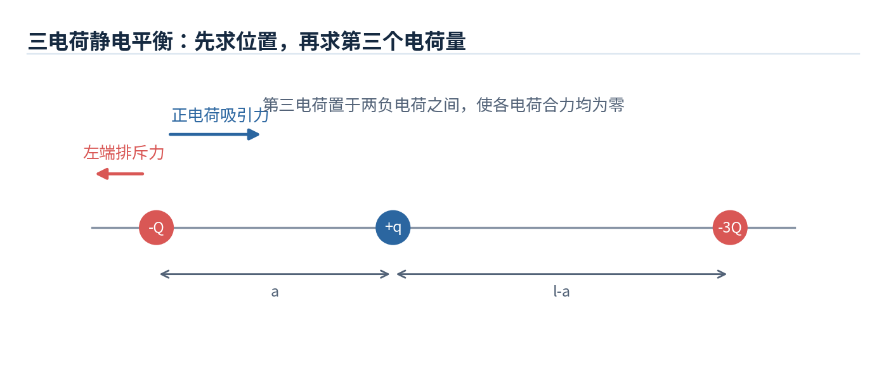

**题目**：$-Q$ 与 $-3Q$ 相距 $l$，要使三者都处于静电平衡，应在何处放置第三个电荷，其电荷量是多少？

**思路**：两端负电荷相互排斥，若第三电荷能抵消它们受到的排斥，第三电荷必须为正且置于两者之间。先利用第三电荷处总场为零求位置，再用端点处受力平衡求电荷量。

**解答**：令 $-Q$ 在 $x=0$，$-3Q$ 在 $x=l$，第三电荷 $q$ 在 $x=a$（$0<a<l$）。

$$
\frac{kQ}{a^2}=\frac{3kQ}{(l-a)^2}
\quad\Longrightarrow\quad
\boxed{a=\frac{l}{1+\sqrt3}}.
$$

为使左侧 $-Q$ 受力平衡：

$$
\frac{kQq}{a^2}=\frac{3kQ^2}{l^2}
\quad\Longrightarrow\quad
\boxed{q=\frac{3Q}{(1+\sqrt3)^2}>0}.
$$

此时右侧 $-3Q$ 的合力也为零。**易错点**：只求出 $E=0$ 的位置，还不足以证明三个电荷都平衡；必须补充求 $q$ 并核对端点受力。

#### 例题 19-2：有限长均匀带电细棒的垂直平分线电场（课件第 22–24 页）

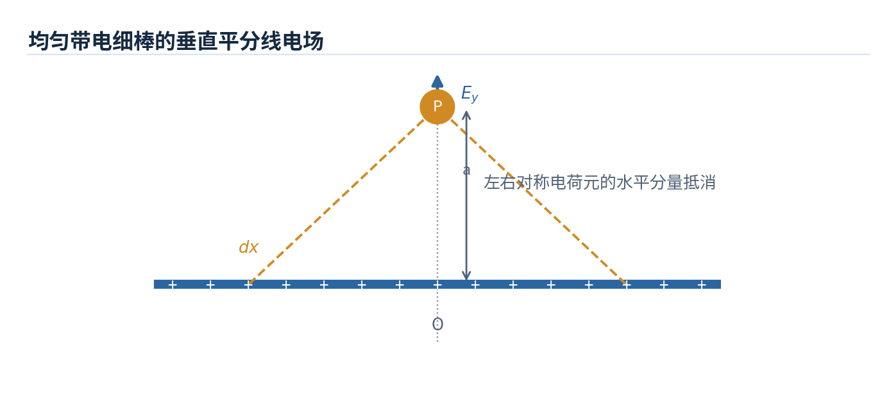

**题目**：长 $L$ 的细棒均匀带电，线密度为 $\lambda$。求其垂直平分线上、距棒中心 $a$ 处的电场；讨论无限长极限。

**思路**：沿棒取 $x$ 轴，棒占据 $[-L/2,L/2]$，场点在 $(0,a)$。来自 $x$ 与 $-x$ 的水平分量抵消，只需积分竖直分量。

**解答**：

$$
\mathrm dE_y=k\frac{\lambda\,\mathrm dx}{x^2+a^2}\frac{a}{\sqrt{x^2+a^2}},
$$

$$
E_y=k\lambda a\int_{-L/2}^{L/2}\frac{\mathrm dx}{(x^2+a^2)^{3/2}}
=\boxed{\frac{k\lambda L}{a\sqrt{a^2+(L/2)^2}}}.
$$

当 $L\to\infty$，$E_y\to2k\lambda/a=\lambda/(2\pi\varepsilon_0a)$。负 $\lambda$ 对应反向电场。

#### 例题 19-3：均匀带电圆环轴线电场及其极大值（课件例 3，第 26–27 页）

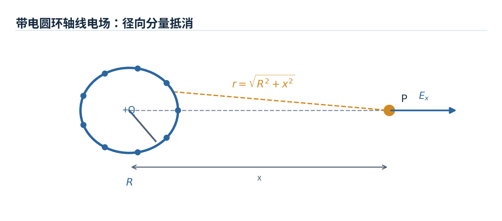

**题目**：半径为 $R$ 的薄圆环带总电荷 $Q>0$，求其轴线上距圆心 $x$（$x\ge0$）处的电场，以及电场最大的位置。

**思路**：圆环上电荷元的径向分量两两抵消；每个元到场点的距离同为 $\sqrt{R^2+x^2}$，只叠加轴向分量。

$$
E_x=\int k\frac{\mathrm dQ}{R^2+x^2}\frac{x}{\sqrt{R^2+x^2}}
=\boxed{k\frac{Qx}{(R^2+x^2)^{3/2}}}.
$$

令 $\mathrm dE_x/\mathrm dx=0$：

$$
\frac{\mathrm dE_x}{\mathrm dx}
=kQ\frac{R^2-2x^2}{(R^2+x^2)^{5/2}}=0
\quad\Longrightarrow\quad
\boxed{x_{\max}=\frac{R}{\sqrt2}},
$$

$$
\boxed{E_{\max}=\frac{2kQ}{3\sqrt3\,R^2}}.
$$

**检验**：$x=0$ 时 $E=0$；$x\gg R$ 时 $E\approx kQ/x^2$，圆环远看像一个点电荷。

#### 例题 19-4：带电圆盘与无限带电平面（课件例 5，第 28–29 页）

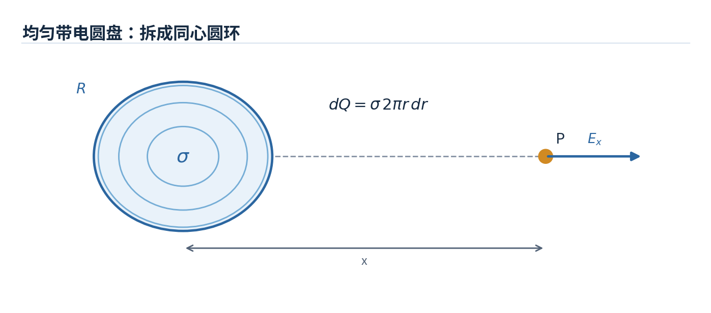

**题目**：半径 $R$ 的圆盘面密度为 $\sigma>0$。求其轴线上 $x>0$ 的电场。

**思路**：将圆盘分割为半径 $r$、宽 $\mathrm dr$ 的同心圆环，$\mathrm dQ=\sigma 2\pi r\,\mathrm dr$；直接套用圆环轴线电场积分。

$$
E_x=k\int_0^R\frac{x\,\sigma2\pi r\,\mathrm dr}{(x^2+r^2)^{3/2}}
=\boxed{\frac{\sigma}{2\varepsilon_0}\left(1-\frac{x}{\sqrt{x^2+R^2}}\right)}.
$$

令 $R\to\infty$，得到无限大薄平面单侧 $E=\sigma/(2\varepsilon_0)$。若两块无限大薄平面分别带 $+\sigma$、$-\sigma$，两板间的场相加为 $\sigma/\varepsilon_0$，外部相消为零（忽略边缘效应）。

#### 例题 19-5：带电圆环使电荷发生简谐运动（课件第 33 页）

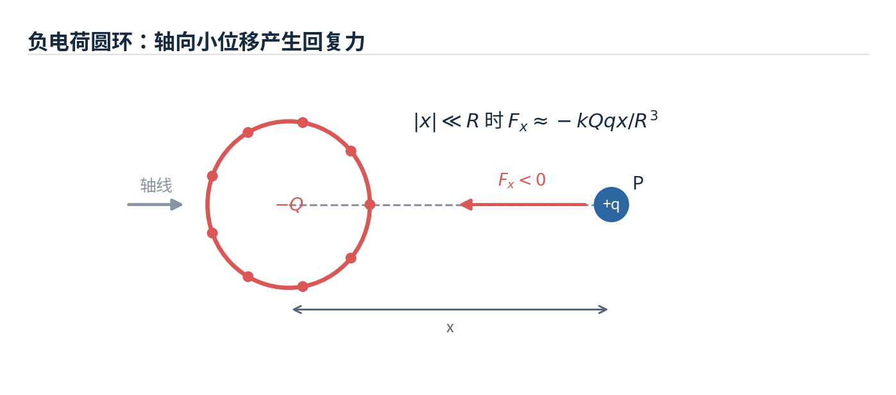

**题目**：半径为 $R$ 的圆环带总电荷 $-Q$（$Q>0$）。质量为 $m$、电荷量为 $q>0$ 的粒子在轴线上距中心微小位移 $x$ 处释放，证明近似作简谐运动并求周期。

**思路**：先用圆环轴向电场写出力，再利用 $|x|\ll R$ 的近似；若得到 $F=-\kappa x$，即为简谐运动。

$$
F_x=-\frac{kQqx}{(R^2+x^2)^{3/2}}
\approx -\frac{kQq}{R^3}x.
$$

因此

$$
\omega^2=\frac{kQq}{mR^3},\qquad
\boxed{T=2\pi\sqrt{\frac{mR^3}{kQq}}}.
$$

仅在轴向小振幅、其他作用可忽略时成立。

---

## 第 20 章：高斯定律（Gauss's Law）

### 20-1 电通量（Electric Flux）

电通量刻画电场穿过曲面的多少。对面积为 $S$ 的**平面**及匀强电场：

$$
\Phi_E=\vec E\cdot\vec S=ES\cos\theta,
$$

其中 $\theta$ 是电场方向与**面法线**的夹角，而非与平面的夹角。任意曲面：

$$
\Phi_E=\int_S\vec E\cdot\mathrm d\vec S.
$$

闭合曲面使用带圈积分号：

$$
\boxed{\Phi_E=\oint_S\vec E\cdot\mathrm d\vec S}.
$$

**符号约定**：闭合曲面面元法线总指向外侧；电场线流出为正通量，流入为负通量。电通量可为零，即使曲面上处处存在非零电场。

### 20-2 高斯定律（Gauss's Law）

$$
\boxed{\oint_S\vec E\cdot\mathrm d\vec S=\frac{Q_{\mathrm{inside}}}{\varepsilon_0}}
$$

- $Q_{\mathrm{inside}}$ 是高斯面**内部净电荷的代数和**。
- $\vec E$ 是**内外全部电荷**共同产生的总电场；但闭合面**净通量只由内部净电荷决定**。
- $Q_{\mathrm{inside}}=0$ 只意味着 $\Phi_E=0$，**不意味着 $\vec E=0$**。
- 高斯定律对任意闭合面成立，但用它**直接解出 $E$** 一般需要球对称、柱对称或平面对称。

**高斯面选择三步法**：找对称性 → 选取能使 $E$ 恒定或 $\vec E\cdot\mathrm d\vec S=0$ 的闭合面 → 计算所围净电荷并求 $E$。高斯面是想象中的数学曲面，不是带电物体实际表面。

### 20-3 高斯定律的典型应用（Applications）

| 电荷分布                                         | 内部 $r<R$                                           | 外部 $r>R$                                |
| ------------------------------------------------ | ---------------------------------------------------- | ----------------------------------------- |
| 半径 $R$、总电荷 $Q$ 的**均匀带电薄球壳**        | $\vec E=0$                                           | $\vec E=kQ\hat r/r^2$                     |
| 半径 $R$、总电荷 $Q$ 的**均匀带电实心绝缘球**    | $\vec E=kQr\hat r/R^3=\rho r\hat r/(3\varepsilon_0)$ | $\vec E=kQ\hat r/r^2$                     |
| 半径 $R$、体密度 $\rho$ 的**无限长实心绝缘圆柱** | $\vec E=\rho r\hat r/(2\varepsilon_0)$               | $\vec E=\rho R^2\hat r/(2\varepsilon_0r)$ |

表中 $\hat r$ 为径向向外单位矢量，负电荷时场方向由符号自然给出。边界处的场需结合表面是否有自由面电荷判断。

### 20-4 导体与高斯定律（Conductor & Gauss's Law）

**静电平衡的理想导体**具有以下性质：

1. 导体材料内部 $\vec E=0$，否则自由电荷会继续运动。
2. 导体整体为**等势体**，表面切向电场为零，紧靠表面的电场垂直表面。
3. 导体表面外侧法向电场满足 $E_n=\sigma/\varepsilon_0$（真空、表面紧外侧）。
4. 没有内部空腔电荷的普通带电孤立导体，其多余自由电荷分布在外表面；有空腔电荷时内表面可感应出电荷。
5. 导体带空腔且空腔内无电荷时，**静电平衡下空腔内电场为零**，构成静电屏蔽。外部静电场不会进入封闭导体的空腔；但空腔内电荷可能影响导体外场。
6. 表面曲率较大的尖端通常具有较大面电荷密度，也容易出现较强局部电场。

**带电空腔**：若导体本身净电荷 $Q$，在封闭空腔内放入电荷 $q$（不与导体接触），则空腔内壁感应总电荷 $-q$，导体外表面总电荷 $Q+q$。这是通过取位于导体材料中的高斯面得到的。

### 20 章典型例题与解题思路

#### 例题 20-1：均匀带电球壳（课件例 1，第 12–13 页）

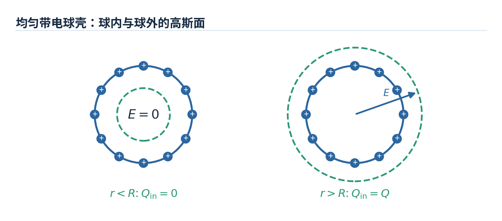

**题目**：半径 $R$ 的薄球壳均匀带总电荷 $Q$，求球壳内外的电场。

**思路**：球对称保证同心球面上 $E$ 的大小相同且沿径向。取半径 $r$ 的同心球形高斯面。

$$
\oint\vec E\cdot\mathrm d\vec S=E(4\pi r^2)=\frac{Q_{\mathrm{inside}}}{\varepsilon_0}.
$$

- $r>R$：$Q_{\mathrm{inside}}=Q$，所以 $\boxed{E=kQ/r^2}$（带符号径向表达）。
- $r<R$：$Q_{\mathrm{inside}}=0$，由球对称可得 $\boxed{\vec E=0}$。

**易错点**：“包围电荷为零所以场为零”在这里成立，**是因为额外用了球对称**，不是由高斯定律单独推出的。

#### 例题 20-2：均匀带电实心绝缘球（课件例 2，第 14 页）

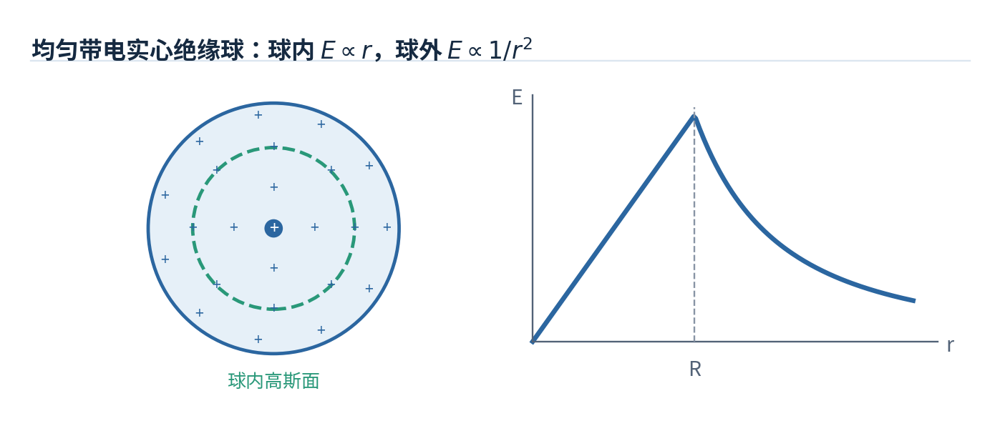

**题目**：半径 $R$ 的球体内均匀分布总电荷 $Q$，求 $E(r)$。

**思路**：内部高斯面只包围半径 $r$ 的部分体积，其电荷按体积比例变化。

$$
Q_{\mathrm{inside}}(r)=Q\frac{\frac43\pi r^3}{\frac43\pi R^3}=Q\frac{r^3}{R^3}.
$$

故

$$
\boxed{\vec E(r)=
\begin{cases}
\dfrac{kQr}{R^3}\hat r,&0\le r<R,\\[5pt]
\dfrac{kQ}{r^2}\hat r,&r\ge R.
\end{cases}}
$$

**物理图像**：球内 $|E|$ 随 $r$ 线性增大（假设 $Q\neq0$），球外按 $1/r^2$ 衰减；与**带电导体实心球内部 $E=0$** 区别开。

#### 例题 20-3：无限长均匀带电圆柱（课件例 3，第 16–17 页）

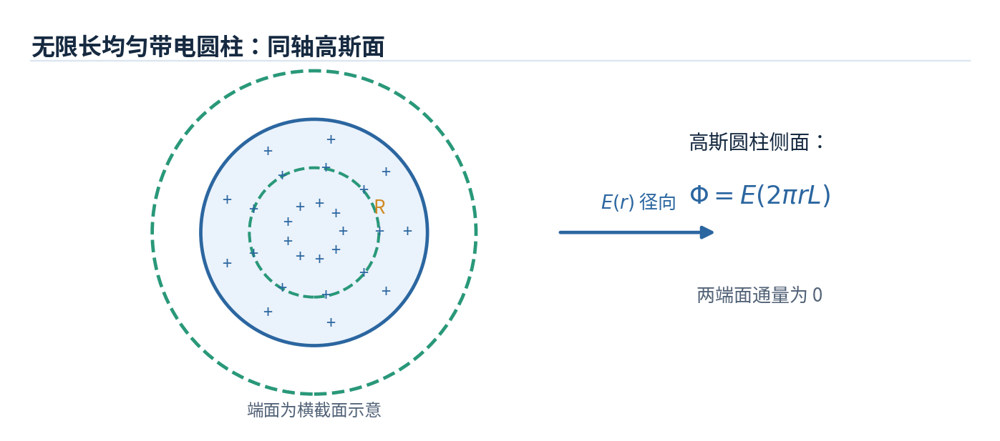

**题目**：半径 $R$、体电荷密度 $\rho$ 的无限长实心圆柱，求内外电场。

**思路**：取半径 $r$、长度 $L$ 的同轴圆柱形高斯面。轴向端面上 $\vec E\cdot\mathrm d\vec S=0$，仅侧面有通量。

$$
E(2\pi rL)=\frac{Q_{\mathrm{inside}}}{\varepsilon_0}.
$$

当 $r<R$ 时 $Q_{\mathrm{inside}}=\rho\pi r^2L$；当 $r>R$ 时 $Q_{\mathrm{inside}}=\rho\pi R^2L$。因此

$$
\boxed{\vec E(r)=
\begin{cases}
\dfrac{\rho r}{2\varepsilon_0}\hat r,&r<R,\\[5pt]
\dfrac{\rho R^2}{2\varepsilon_0r}\hat r,&r>R.
\end{cases}}
$$

**关键**：不要把圆柱两端面面积计入通量；它们的法线与电场垂直。

#### 例题 20-4：均匀带电球挖去偏心球形空腔（课件第 15 页）

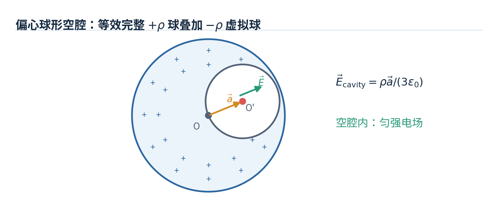

**题目**：体电荷密度 $\rho$ 的大球体中挖去一个不共心的小球形空腔，求空腔内部电场。令 $\vec a$ 为**大球球心 $O$ 指向空腔球心 $O'$** 的位移矢量。

**思路**：用**叠加法**，把实际体系看作完整的密度为 $+\rho$ 的实心球，加上空腔位置密度为 $-\rho$ 的“虚拟球”。

对空腔内任意点 $P$，令 $\vec r=\overrightarrow{OP}$，则 $\overrightarrow{O'P}=\vec r-\vec a$。

$$
\vec E_+=\frac{\rho\vec r}{3\varepsilon_0},\qquad
\vec E_-=-\frac{\rho(\vec r-\vec a)}{3\varepsilon_0}.
$$

两者相加：

$$
\boxed{\vec E_{\mathrm{cavity}}=\frac{\rho\vec a}{3\varepsilon_0}}.
$$

**结论**：空腔内电场是**匀强电场**，且与点 $P$ 的位置无关。

#### 例题 20-5：带电导体空腔的感应电荷（课件第 19 页）

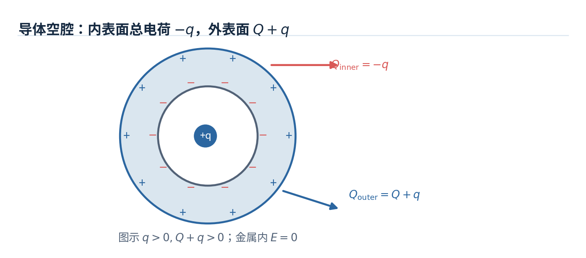

**题目**：净电荷 $Q$ 的孤立导体内部有封闭空腔，空腔内悬置电荷 $q$，求内外表面总电荷。

**思路**：选位于导体材料内部、围绕空腔的高斯面。因导体内 $E=0$，高斯面围住的净电荷为零。

$$
q+Q_{\mathrm{inner}}=0\quad\Rightarrow\quad
\boxed{Q_{\mathrm{inner}}=-q}.
$$

再结合导体本身电荷守恒：

$$
Q_{\mathrm{inner}}+Q_{\mathrm{outer}}=Q
\quad\Rightarrow\quad
\boxed{Q_{\mathrm{outer}}=Q+q}.
$$

**注意**：只能判断内外表面**总量**，不能由此断言电荷在每一处都均匀分布。

#### 例题 20-6：两块大平行金属板的四个表面电荷（课件例 4，第 22–23 页）

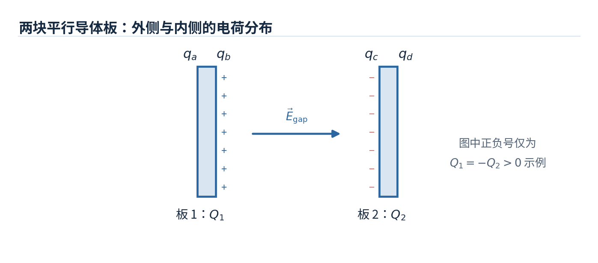
**题目**：面积均为 $S$ 的两块很大的平行金属板带净电荷 $Q_1,Q_2$，求四个表面的带电量和两板间电场（忽略边缘效应）。

**思路**：从左到右给四个表面依次设电荷 $q_a,q_b,q_c,q_d$。分别使用两块金属板的电荷守恒、导体内电场为零，以及平行无限带电面的叠加。

**结果**：

$$
\boxed{q_a=q_d=\frac{Q_1+Q_2}{2}},\qquad
\boxed{q_b=\frac{Q_1-Q_2}{2}},\qquad
\boxed{q_c=\frac{Q_2-Q_1}{2}}.
$$

取从左板指向右板为 $+x$ 方向，两板间电场为

$$
\boxed{\vec E_{\mathrm{gap}}=\frac{Q_1-Q_2}{2\varepsilon_0S}\hat x}.
$$

例如 $Q_1=+Q$、$Q_2=-Q$ 时，外侧均不带净电荷，内侧分别为 $+Q$、$-Q$，间隙中 $E=Q/(\varepsilon_0S)$。

---

## 第 21 章：电势与电势差（Electric Potential）

### 21-1 静电力的保守性、电势能与电势差

静电力是**保守力**：从 $a$ 到 $b$ 的做功只与端点有关，与路径无关。因此沿静电场任意闭合路径，

$$
\boxed{\oint\vec E\cdot\mathrm d\vec l=0}.
$$

定义电势能 $U$，则静电力做功

$$
W_{a\to b}^{(\mathrm e)}=U_a-U_b=-\Delta U.
$$

电势定义为**单位正电荷的电势能**（在选定参考零点之后）：

$$
\boxed{V=\frac{U}{q}},\qquad
\boxed{V_b-V_a=-\int_a^b\vec E\cdot\mathrm d\vec l}.
$$

对电荷 $q$ 有 $\Delta U=q(V_b-V_a)$ 和 $W_{a\to b}^{(\mathrm e)}=q(V_a-V_b)$。

- **电势 $V$** 是标量，电场 $\vec E$ 是矢量。
- 电势零点可任意选择，**电势差不依赖**于零点；孤立局域电荷分布通常约定 $V(\infty)=0$。
- 顺着电场方向移动，电势降低（沿场线 $\mathrm dV<0$）。**负电荷**沿电场方向移动时，其电势能反而增加，因为 $U=qV$。

### 21-2 电场与电势的关系

由电场求电势差：

$$
\boxed{\Delta V=-\int\vec E\cdot\mathrm d\vec l}.
$$

由电势求电场：

$$
\boxed{\vec E=-\nabla V}
$$

直角坐标下

$$
E_x=-\frac{\partial V}{\partial x},\qquad
E_y=-\frac{\partial V}{\partial y},\qquad
E_z=-\frac{\partial V}{\partial z}.
$$

如果场只沿 $x$ 方向变化且电场沿 $x$ 方向，则 $E_x=-\mathrm dV/\mathrm dx$。**负号**表示电场指向电势下降最快的方向。

### 21-3 电势的计算（Calculation of Electric Potential）

令 $V(\infty)=0$，点电荷 $Q$ 的电势：

$$
\boxed{V(r)=\frac{kQ}{r}}.
$$

点电荷系满足**标量叠加**，连续分布则用积分：

$$
\boxed{V(P)=\sum_i\frac{kQ_i}{r_i}},\qquad
\boxed{V(P)=k\int\frac{\mathrm dQ}{r}}.
$$

重要区别：计算 $\vec E$ 时对**矢量**分量积分；计算 $V$ 时直接对**标量**求和，往往更简单。

常见结果（$V(\infty)=0$）：

| 分布                                 | 电势                     |
| ------------------------------------ | ------------------------ |
| 球外的球对称带电体（总电荷 $Q$）     | $V(r)=kQ/r$，$r\ge R$    |
| 带总电荷 $Q$ 的导体球内部及表面      | $V(r)=kQ/R$，$r\le R$    |
| 均匀带电圆环的轴线上                 | $V(x)=kQ/\sqrt{x^2+R^2}$ |
| 均匀带电细棒轴向延长线、距近端 $a>0$ | $V=k\lambda\ln[(a+L)/a]$ |

### 21-5 等势面（Equipotential Surfaces）

- 等势面上各点 $V$ 相同，**沿等势面移动电荷，静电力做功为零**。
- 电场线处处垂直等势面；两者不能在同一点斜交。
- 在相同电势差的相邻等势面之间，距离越小意味着平均电场越强。
- 静电平衡的导体是等势体，其表面也是等势面。
- 对均匀电场，等势面为一组垂直于 $\vec E$ 的平行平面；点电荷的等势面是同心球面。

### 21-7 由电势求电场（$\vec E$ Determined from $V$）

梯度 $\nabla V$ 指向电势上升最快的方向，$\vec E=-\nabla V$ 指向下降最快的方向。处理三维函数时，**三个偏导数都要检查**；不能只对一个自变量求导便当作整个电场。

### 21 章典型例题与解题思路

#### 例题 21-1：电势差与静电力做功（对应课件第 9–10 页的电荷移动题）

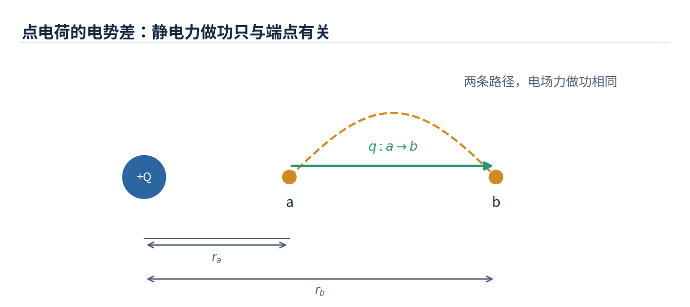

**题目**：一点电荷 $Q$ 位于原点，将试探电荷 $q$ 从距原点 $r_a$ 的位置移动到 $r_b$。求静电力做功和电势能变化。

**思路**：库仑力是保守力，路径没有影响；先求两个端点的电势，再用 $W=q(V_a-V_b)$。

$$
V_a=\frac{kQ}{r_a},\qquad V_b=\frac{kQ}{r_b}.
$$

$$
\boxed{W_{a\to b}^{(\mathrm e)}=kQq\left(\frac1{r_a}-\frac1{r_b}\right)},
$$

$$
\boxed{\Delta U=kQq\left(\frac1{r_b}-\frac1{r_a}\right)=-W_{a\to b}^{(\mathrm e)}}.
$$

**判断正负**：若 $Qq>0$ 且 $r_b>r_a$，电场力做正功，电势能减小；如果有人施加外力并缓慢移动电荷，外力做功与此相反。

#### 例题 21-2：均匀带电导体球的电势（课件例 2，第 11–12 页）

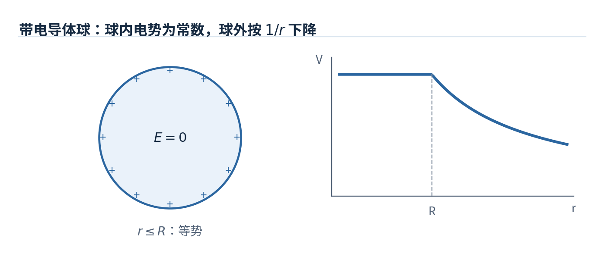

**题目**：半径 $R$ 的孤立导体球带电 $Q$，求各处电势。

**思路**：由第 20 章，球内 $E=0$、球外 $E=kQ/r^2$；取无穷远为零点，对球外积分并利用导体等势性质。

$$
\boxed{V(r)=
\begin{cases}
\dfrac{kQ}{R},&0\le r\le R,\\[5pt]
\dfrac{kQ}{r},&r>R.
\end{cases}}
$$

**核心**：导体内虽 $E=0$，但 $V$ 一般**不为零**，而是一个常量。

#### 例题 21-3：均匀带电细棒的轴向电势（课件例 3，第 13 页）

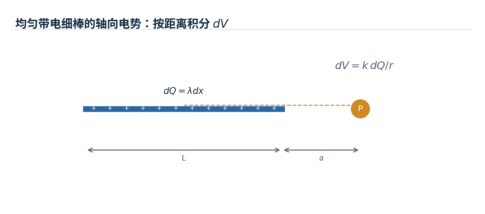

**题目**：长度 $L$、线密度 $\lambda$ 的细棒，求延长线上距近端 $a>0$ 处的电势，零点在无穷远。

**思路**：从近端量起取电荷元 $\mathrm dQ=\lambda\,\mathrm dx$，到场点距离为 $a+x$；对标量 $\mathrm dV=k\mathrm dQ/(a+x)$ 积分。

$$
V=k\lambda\int_0^L\frac{\mathrm dx}{a+x}
=\boxed{k\lambda\ln\frac{a+L}{a}}.
$$

**检查**：$a\gg L$ 时，$\ln(1+L/a)\approx L/a$，于是 $V\approx k\lambda L/a=kQ/a$，与远处点电荷近似一致。

#### 例题 21-4：带电圆环轴线上的电势与电场（课件例 4，第 14 页）

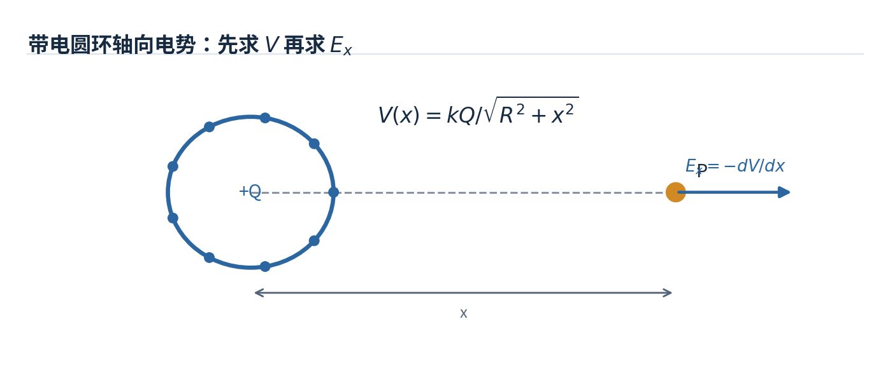

**题目**：半径 $R$ 的薄圆环均匀带电 $Q$，求轴线上位置 $x$ 的电势，并由电势求电场。

**思路**：圆环上所有电荷元到轴线点的距离相同，可直接积分电势；然后用 $E_x=-\mathrm dV/\mathrm dx$。

$$
V(x)=k\int\frac{\mathrm dQ}{\sqrt{x^2+R^2}}
=\boxed{\frac{kQ}{\sqrt{x^2+R^2}}}.
$$

$$
E_x=-\frac{\mathrm dV}{\mathrm dx}
=\boxed{\frac{kQx}{(x^2+R^2)^{3/2}}}.
$$

这与第 19 章直接积分电场所得结论相同，构成**两种方法相互校验**。

#### 例题 21-5：已知电势函数求电场（对应课件例 5，第 28 页）

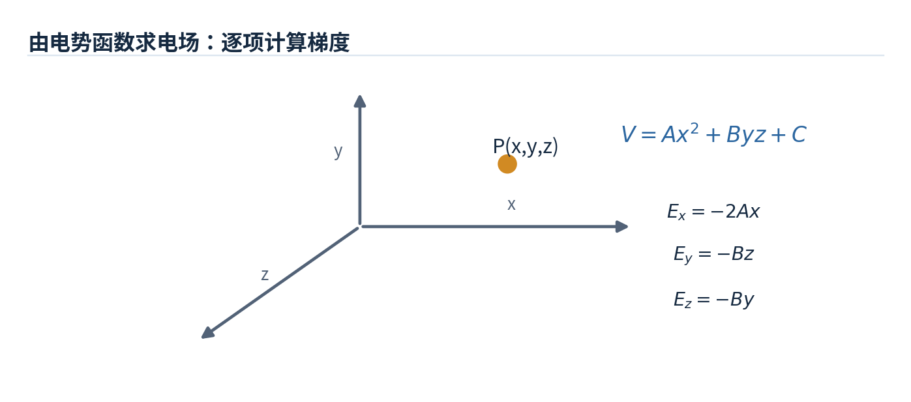

**题目（练习化改写）**：某区域电势为 $V(x,y,z)=Ax^2+Byz+C$，其中 $A,B,C$ 为常数，求 $\vec E$。

**思路**：逐项计算偏导，再整体加负号。

$$
\frac{\partial V}{\partial x}=2Ax,\qquad
\frac{\partial V}{\partial y}=Bz,\qquad
\frac{\partial V}{\partial z}=By.
$$

$$
\boxed{\vec E=-2Ax\hat x-Bz\hat y-By\hat z}.
$$

**注意**：常数 $C$ 不影响电场。此题的具体函数为便于练习而给出的**补充示例**，不是声称课件例 5 使用了同一函数。

#### 例题 21-6：均匀带电圆锥侧面顶点电势（课件第 15 页）

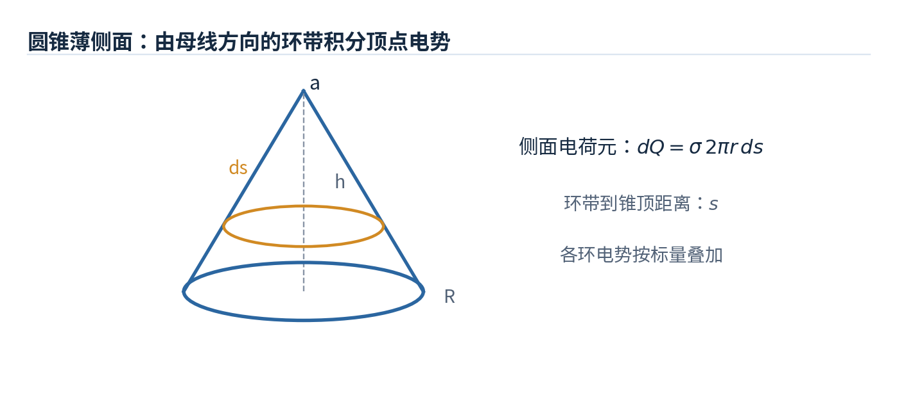

**题目**：高 $h$、底面半径 $R$ 的圆锥薄侧面均匀带面密度 $\sigma$，求顶点处电势（无穷远为零）。

**思路**：从锥顶沿母线取宽 $\mathrm ds$ 的环形带，设母线全长 $\ell=\sqrt{h^2+R^2}$。该环半径 $r=(R/\ell)s$，面积 $\mathrm dS=2\pi r\,\mathrm ds$；其到顶点距离为 $s$。

$$
V=k\int_0^\ell\frac{\sigma\,2\pi(R/\ell)s\,\mathrm ds}{s}
=2\pi k\sigma R.
$$

所以

$$
\boxed{V_{\mathrm{tip}}=\frac{\sigma R}{2\varepsilon_0}}.
$$

**特点**：在 $\sigma$ 与 $R$ 固定的条件下，结果不显含高度 $h$；注意这里只计算**圆锥侧面**上的电荷，不含底面。

---

## 第 22 章：电容、电介质与静电能（Capacitance, Dielectrics, Electric Energy Storage）

### 22-1 电容器与电容（Capacitors & Capacitance）

电容器由彼此绝缘的导体构成，用来存储等量异号电荷 $+Q$、$-Q$。电容定义：

$$
\boxed{C=\frac{Q}{\Delta V}},\qquad Q=C\Delta V.
$$

电容单位为法拉（F），常见有 $\mu\mathrm F$、$\mathrm{nF}$、$\mathrm{pF}$。

- 对给定几何构型和线性介质，$C$ 由**形状、尺寸、相对位置及介电性质**决定，不由当前 $Q$ 或 $\Delta V$ 决定。
- 电容器在理想情况下储存电荷和电场能量，不是凭空产生电荷的器件。
- 如果某电容器两端电压加倍且 $C$ 不变，则 $Q$ 加倍；这是课件第 6 页选择题的关键。

### 22-2 典型几何结构的电容（Determination of Capacitance）

**平行板电容器**（极板面积 $S$、板距 $d$、忽略边缘效应）：

$$
\boxed{C_0=\frac{\varepsilon_0S}{d}}.
$$

**长同轴圆柱形电容器**（内、外导体半径 $R_1<R_2$，长度 $L\gg R_2$，忽略端部效应）：

$$
\boxed{C=\frac{2\pi\varepsilon_0L}{\ln(R_2/R_1)}}.
$$

**同心球形电容器**（内、外导体半径 $R_1<R_2$）：

$$
\boxed{C=4\pi\varepsilon_0\frac{R_1R_2}{R_2-R_1}}.
$$

当外球半径 $R_2\to\infty$，孤立导体球电容为 $C=4\pi\varepsilon_0R_1$。若全部间隙充满均匀线性电介质，上述 $\varepsilon_0$ 可替换为材料的 $\varepsilon=\kappa\varepsilon_0$。

### 22-3 电容器的串联与并联（Series and Parallel）

| 连接方式                     | 不变量                                             | 等效电容                                                 |
| ---------------------------- | -------------------------------------------------- | -------------------------------------------------------- |
| **串联**（理想、无其他支路） | 各电容器电荷量大小相同，$Q_1=Q_2=\cdots$；电压相加 | $\displaystyle\frac1{C_{\mathrm{eq}}}=\sum_i\frac1{C_i}$ |
| **并联**                     | 各电容器电压相同，$V_1=V_2=\cdots$；电荷量相加     | $\displaystyle C_{\mathrm{eq}}=\sum_iC_i$                |

- 串联等效电容小于其中任意一个电容；并联等效电容大于其中任意一个电容（正电容情形）。
- 判断网络连接时，**看节点而不是看图画位置**。两个元件连接同一对节点才是并联；串联的中间节点不能接入产生分流的其他支路。
- **接着电池**通常意味着总电压被固定；**断开电池且系统绝缘**通常意味着相关孤立导体的自由电荷保持不变。具体还要结合接线与哪些节点是孤立的判断。

### 22-4 电容器储能与电场能量密度（Electric Energy Storage）

将电荷逐渐从 $0$ 充至 $Q$，在某时刻电压为 $V=q/C$，外界所做可逆充电功成为静电能：

$$
U=\int_0^Q\frac{q}{C}\,\mathrm dq
=\boxed{\frac{Q^2}{2C}=\frac12QV=\frac12CV^2}.
$$

均匀介质中的电场能量密度：

$$
\boxed{u=\frac12\varepsilon E^2},
$$

真空中 $u=\frac12\varepsilon_0E^2$。对一般线性、各向同性的均匀电介质，亦可写成 $u=\tfrac12\vec E\cdot\vec D$。全空间场能为 $U=\int u\,\mathrm dV$。

**选公式的诀窍**：题目固定电荷时宜用 $U=Q^2/(2C)$；固定电压时宜用 $U=CV^2/2$。不要忽略电池是否连接。

### 22-5 电介质（Dielectrics）

电介质是放在极板间的绝缘物质，能产生**极化**。相对介电常数 $\kappa=\varepsilon/\varepsilon_0$，在线性均匀介质完全填满几何不变的电容器时：

$$
\boxed{C=\kappa C_0}.
$$

**两种边界条件**（完整填充、理想线性介质）：

| 量                   | 电池仍连接：$V$ 固定 | 电池断开且电荷无法流失：$Q$ 固定 |
| -------------------- | -------------------- | -------------------------------- |
| 电容 $C$             | 变为 $\kappa C_0$    | 变为 $\kappa C_0$                |
| 电荷 $Q$             | 变为 $\kappa Q_0$    | 不变                             |
| 电压 $V$             | 不变                 | 变为 $V_0/\kappa$                |
| 电场 $E$（几何固定） | 不变                 | 变为 $E_0/\kappa$                |
| 储能 $U$             | 变为 $\kappa U_0$    | 变为 $U_0/\kappa$                |

> **重要限定**：表中“接电池时 $E$ 不变”依赖理想平行板的 $E=V/d$、板距不变及忽略边缘效应；“断开时 $Q$ 固定”依赖电荷无泄漏且各电容与电源确实隔离。不能无条件推广到任意非均匀结构。

电介质还可以提高电容器的耐压能力，但**击穿场强**由具体材料决定，不能简单用 $\kappa$ 直接换算击穿电压。

### 22-6 电介质的分子图像（Molecular Description of Dielectrics）

- **极性分子**（课件举例：$\mathrm{H_2O}$、CO）：自身有永久电偶极矩；外场会使偶极矩倾向取向排列。
- **非极性分子**（课件举例：$\mathrm{O_2}$、$\mathrm{N_2}$）：无永久电偶极矩，外场使正负电荷中心发生相对位移，产生**诱导偶极矩**。
- **极化**：介质内部形成束缚电荷（polarization / bound charge），其诱导电场通常部分抵消外加场；这里说“部分抵消”指给定自由电荷时的情形，不表示介质中的电场处处为零。
- **现象联系**：带电物体能吸引碎纸屑或偏折细水流，与介质极化及非均匀电场作用相关；电容式触摸屏通过电容变化感知触摸。

### 22 章典型例题与解题思路

#### 例题 22-1：同轴圆柱形电容器（课件例 1，第 7 页）

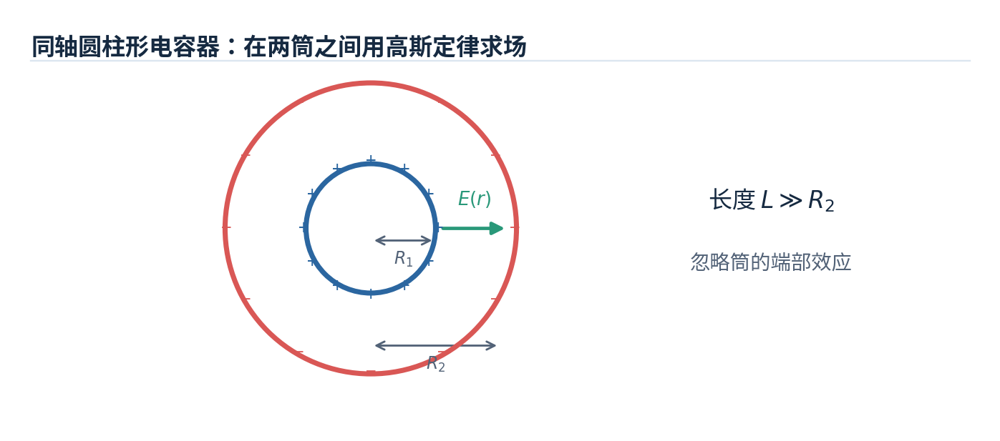

**题目**：两同轴圆柱壳半径分别为 $R_1,R_2$（$R_1<R_2$），长度 $L\gg R_2$，内外导体携带 $+Q,-Q$，求电容。

**思路**：先用柱形高斯面求场，再积分两导体之间的电势差，最后 $C=Q/\Delta V$。

设单位长度带电量 $\lambda=Q/L$：

$$
E(r)=\frac{\lambda}{2\pi\varepsilon_0r},\qquad R_1<r<R_2.
$$

$$
\Delta V=V(R_1)-V(R_2)
=\int_{R_1}^{R_2}E(r)\,\mathrm dr
=\frac{Q}{2\pi\varepsilon_0L}\ln\frac{R_2}{R_1}.
$$

因此

$$
\boxed{C=\frac{2\pi\varepsilon_0L}{\ln(R_2/R_1)}}.
$$

#### 例题 22-2：同心球形电容器（课件第 8 页）

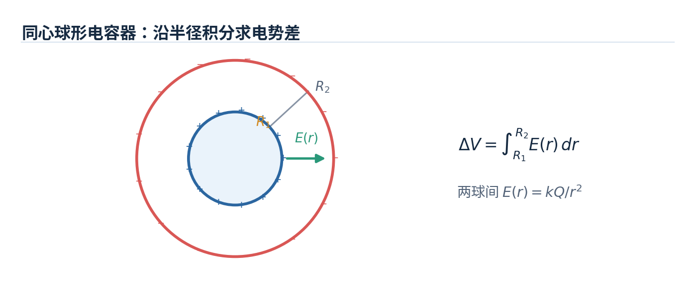

**题目**：内球半径 $R_1$、外球壳内半径 $R_2$，两导体净电荷分别为 $+Q,-Q$，求电容。

**思路**：球形高斯面给出两球之间 $E(r)=kQ/r^2$，对半径积分求电势差。

$$
\Delta V=\int_{R_1}^{R_2}\frac{kQ}{r^2}\,\mathrm dr
=kQ\left(\frac1{R_1}-\frac1{R_2}\right).
$$

$$
\boxed{C=\frac{Q}{\Delta V}=
4\pi\varepsilon_0\frac{R_1R_2}{R_2-R_1}}.
$$

**进一步**：令 $R_2\to\infty$，得到 $C=4\pi\varepsilon_0R_1$。

#### 例题 22-3：平行板电容器的数值计算与储能（课件例 4，第 13 页）

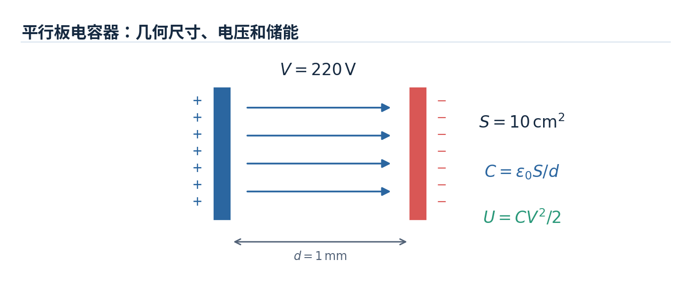

**题目**：平行板电容器板距 $d=1\,\mathrm{mm}$、板面积 $S=10\,\mathrm{cm^2}$，电压 $V=220\,\mathrm V$；忽略边缘效应，求电容和储能。

**思路**：先将单位换为 SI 制：$d=1.0\times10^{-3}\,\mathrm m$，$S=1.0\times10^{-3}\,\mathrm{m^2}$。再分别使用 $C=\varepsilon_0S/d$ 和 $U=CV^2/2$。

$$
\boxed{C=8.854\times10^{-12}\,\mathrm F\approx8.85\,\mathrm{pF}},
$$

$$
\boxed{U=\frac12(8.854\times10^{-12})(220)^2
\approx2.14\times10^{-7}\,\mathrm J}.
$$

**提示**：本题的 $220\,\mathrm V$ 是给定电压，并不表示对任何实际电容器都安全；最大可储能还受绝缘材料的击穿场强限制。

#### 例题 22-4：断电后给串联电容器之一填充介质（课件第 19 页选择题）

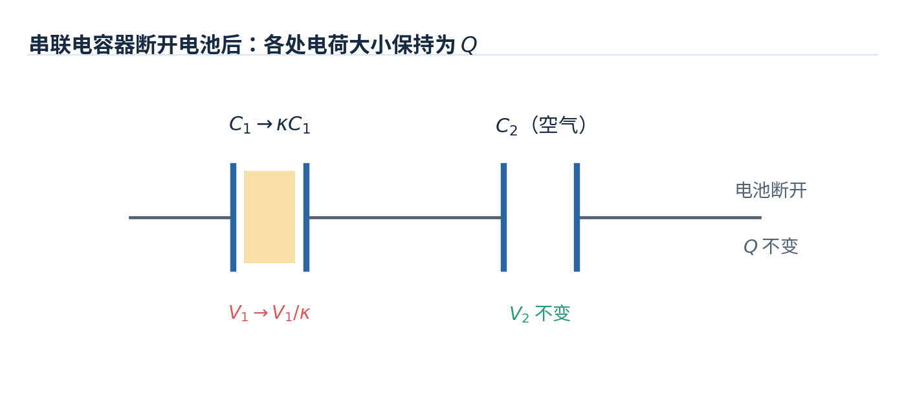

**题目**：两个空气电容器 $C_1,C_2$ 串联，充电后将电池断开，并保持所有电极与外界绝缘。向 $C_1$ 完全填入相对介电常数 $\kappa>1$ 的介质，两个电容器的端电压如何变化？

**思路**：隔离的串联组合中原有串联电荷量 $Q$ 不变。填介质后 $C_1'=\kappa C_1$，$C_2$ 不变。

$$
V_1'=\frac{Q}{\kappa C_1}=\frac{V_1}{\kappa},\qquad
V_2'=\frac{Q}{C_2}=V_2.
$$

**答案**：$C_1$ 的电压**减小**，$C_2$ 的电压**保持不变**；对应课件选择题中的第二种描述（B）。

#### 例题 22-5：平行板电容器“填充一半”介质（课件第 20 页）

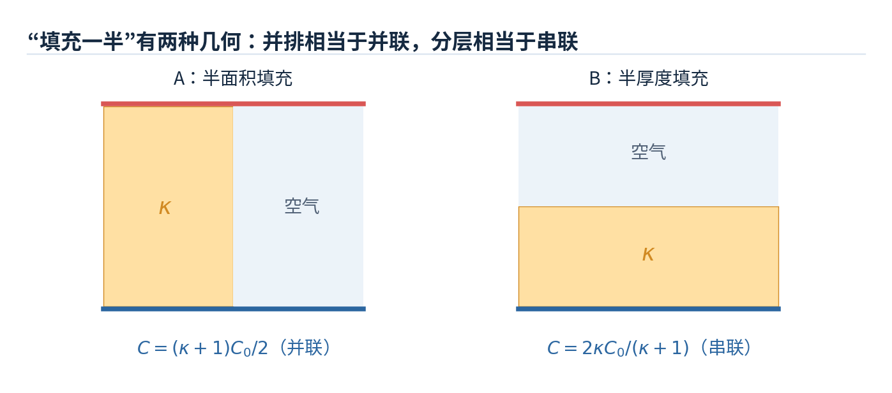

**题目**：原平行板面积 $S$、板距 $d$、空气电容 $C_0=\varepsilon_0S/d$，用介电常数 $\kappa$ 的材料填充“一半”，求新电容。

**思路**：“填充一半”有两种**不同几何意义**，必须看图判断等效串并联。

**情形 A：占据一半极板面积，厚度贯穿整个板距**。两半区域电压相同，相当于并联：

$$
C=\frac{\kappa\varepsilon_0(S/2)}d+\frac{\varepsilon_0(S/2)}d
=\boxed{\frac{\kappa+1}{2}C_0}.
$$

**情形 B：占据一半板距，面积覆盖整个极板**。两层介质承受的电荷相同，相当于串联：

$$
\frac1C=\frac{d/2}{\kappa\varepsilon_0S}+\frac{d/2}{\varepsilon_0S}
\quad\Longrightarrow\quad
\boxed{C=\frac{2\kappa}{\kappa+1}C_0}.
$$

**易错点**：只写“半填充”无法决定答案；一定要区分**并排面积填充**和**沿场方向厚度填充**。

#### 例题 22-6：从带电电容器中抽出电介质，能量从哪里来？（课件第 23 页思考题）

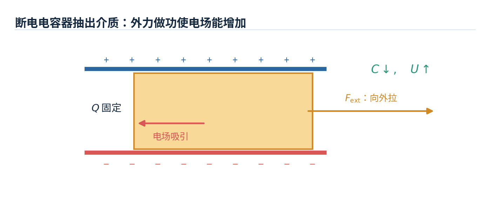

**题目**：一只充电后的电容器已与电池断开，现将填入的电介质缓慢抽出。为什么电场能量可能增加？

**思路**：断电后 $Q$ 不变；抽出介质使电容 $C$ 减小，因此 $U=Q^2/(2C)$ 增大。增加的电场能来自**外力克服电场吸引电介质所做的机械功**。

$$
\Delta U=\frac{Q^2}{2}\left(\frac1{C_{\mathrm{after}}}-\frac1{C_{\mathrm{before}}}\right)>0.
$$

若电容器仍连接理想电池，电势差固定，必须同时考虑电池供能或吸能，不能仅比较 $\frac12CV^2$ 就当作全过程的机械功。

### 22 章课件末尾的扩展提示

课件末页提醒 **Chapter 23–24（Electric Current and Resistance）** 可自行预习，涉及电流、电流密度、电阻、欧姆定律、导电率和电阻率。这些内容可在后续章节中继续补充。

---

### 静电学知识联系与常见易错点（阶段复习）

**知识链**：

$$
\boxed{\text{电荷分布}\ \xrightarrow{\text{库仑定律/高斯定律}}\ \vec E
\ \xrightarrow{\,-\int\vec E\cdot\mathrm d\vec l\,}\ V
\ \xrightarrow{\,U=qV,\ C=Q/\Delta V\,}\ \text{电势能与电容}}
$$

反向求场则用 $\vec E=-\nabla V$。需要强调的是，高斯定律适合**高对称性**，并不是任意分布求场都比库仑积分简便。

| 易错认识                             | 正确判断                                                              |
| ------------------------------------ | --------------------------------------------------------------------- |
| 高斯面内净电荷为零，所以面上电场为零 | 仅能推知**净电通量为零**，电场仍可能非零                              |
| 导体内部电场为零，所以电势为零       | 导体内部**电势为常数**，不一定为零                                    |
| 电场与电势都是矢量                   | $\vec E$ 为矢量，$V$ 为标量                                           |
| 电场一定指向电势“数值更大”的方向     | 电场指向**电势降低**的方向                                            |
| 负电荷沿电场运动，电势能一定减小     | $\Delta U=q\Delta V$，对负电荷取向需仔细判断                          |
| 串联电容器电压相同                   | 串联一般**电荷量相同**；并联电压相同                                  |
| 电容随电荷和电压成比例变化           | 线性电容的 $C$ 由几何与材料决定，$Q$ 才随 $V$ 变化                    |
| 加电介质后电场和电荷总是减小         | 取决于**接电池（定电压）**还是**断开（定电荷）**                      |
| 题目说“填充一半”就能直接套唯一公式   | 必须区分**半面积并联**和**半厚度串联**                                |
| 非导体无限带电平面与导体表面公式相同 | 前者每侧 $\sigma/(2\varepsilon_0)$；后者紧外侧 $\sigma/\varepsilon_0$ |

### 复习自测（建议闭卷完成）

1. 已知两个点电荷的大小与位置，如何用矢量叠加确定空间一点的电场方向？
2. 为什么均匀带电圆环在圆心电场为零，但电势不一定为零？
3. 高斯定律如何分别求均匀带电球壳、实心球体、长圆柱内外的电场？
4. 为什么处于静电平衡的导体材料内部不能存在非零电场？
5. 已知 $V(x,y,z)$，如何求 $E_x,E_y,E_z$？
6. 电容器断开电池后插入介质，$C,Q,V,U$ 如何变化？若电池始终连接，哪些结果会改变？
7. 对球形电容器，如何分别用 $U=Q^2/(2C)$ 和 $U=\int\frac12\varepsilon_0E^2\,\mathrm dV$ 验证总能量一致？

**建议学习顺序**：先掌握库仑积分与电场方向 → 再训练高斯面的选取 → 然后熟练区分 $E,V,U$ → 最后练习电容器在**定 $Q$ / 定 $V$** 两种条件下的变化题。

### 当前已整理章节的课件来源

| 文件                                  | 本笔记的主要内容                             | 课件中典型例题位置       |
| ------------------------------------- | -------------------------------------------- | ------------------------ |
| `Ch19 Electric Field.pptx`            | 电荷、库仑定律、电场、连续电荷分布、电偶极子 | 幻灯片 20、22–29、33     |
| `Ch20 Gauss's law.pptx`               | 电通量、高斯定律、对称电场、导体与静电屏蔽   | 幻灯片 12–17、19、22–23  |
| `Ch21 Electric potential.pptx`        | 静电势能、电势、电势计算、等势面、梯度       | 幻灯片 9–15、23–29       |
| `Ch22 Capacitance & Dielectrics.pptx` | 电容器、串并联、静电能、电介质、极化         | 幻灯片 7–8、13–15、19–23 |

> **说明**：目前已整理的章节以相应课件为主要依据；部分公式补充了推导，部分课堂互动题未收录。例题配图为依据题设重新绘制的示意图，而非课件原图；若课件的特定坐标、接线和介质方向与示意图表述有差异，应以题目原图和文字条件为准。
